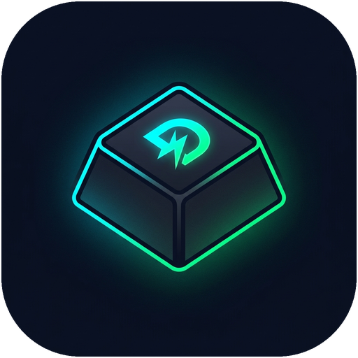

<div align="center">
  
  <h1>⚡ MiniTelex</h1>
  <p><b>Bộ gõ Tiếng Việt kiểu Telex tối giản chuyên biệt cho Game thủ trên Windows</b></p>
  <p><i>Vừa chơi game mượt 100% không khựng/liệt phím WASD — Vừa chat Tiếng Việt & Tiếng Anh thông minh</i></p>
</div>

---

## 🎯 Giới thiệu

Khi sử dụng các bộ gõ Tiếng Việt truyền thống (như Unikey) ở chế độ **Telex** trong lúc chơi game (Valorant, CS2, Liên Minh Huyền Thoại, Đấu Trường Chân Lý - TFT, Genshin Impact...), các phím di chuyển và tung chiêu (`W, A, S, D, Q, E, R, F`) bị trùng với các phím bỏ dấu của Telex (`W` -> *ư*, `A+S` -> *á*, `D+D` -> *đ*). Điều này khiến nhân vật bị đứng hình, khựng phím hoặc liệt nút.

**MiniTelex** được xây dựng để giải quyết triệt để vấn đề này một cách **tự động hoàn toàn** mà người chơi không cần phải liên tục bấm tắt/bật bộ gõ thủ công.

---

## ✨ Tính năng nổi bật

* 🛡️ **Chống liệt phím `WASD` & Chiêu thức tuyệt đối trong Game:**
  * Tự động nhận diện các tựa game (Valorant, CS2, LMHT, TFT, Genshin Impact, PUBG, Dota 2, Naraka... và mọi tựa game chạy chế độ Fullscreen / Borderless).
  * Khi đang di chuyển hoặc giao tranh (con trỏ chuột ẩn ngắm bắn, nhấn giữ phím di chuyển, bấm tổ hợp phím chéo `W+A`, `W+D`, lách né đòn `A+S`, `D+D`), toàn bộ phím được truyền thẳng vào game với độ trễ `0ms`.
* 💬 **Tự động Bật / Thoát chế độ Chat trong Game:**
  * **Mở Chat bằng phím `Enter` (Valorant, CS2, LMHT...):** Tự động bật gõ Tiếng Việt khi bấm `Enter` mở khung chat, và tự động khóa lại về chế độ chơi game ngay khi bấm `Enter` gửi tin nhắn, bấm `Esc`, hoặc di chuyển.
  * **Mở Chat bằng Click Chuột (TFT, LMHT, Genshin...):** Tự động nhận diện khi con trỏ chuột hiển thị và người chơi click vào ô chat để gõ chữ; tự động thoát chế độ chat khi click chuột ra ngoài màn hình game.
* 🔄 **Tự động nhận diện `Alt + Tab` ra ngoài Desktop:**
  * Ngay khi `Alt + Tab` sang trình duyệt (Chrome, Edge, Cốc Cốc), Zalo, Discord, Messenger..., MiniTelex tự động chuyển sang chế độ gõ Tiếng Việt Telex đầy đủ 100%.
* 🧠 **Nhận diện từ Tiếng Anh & Sửa lỗi gõ nhanh thông minh:**
  * Tự động phát hiện cấu trúc từ Tiếng Anh (*MiniTelex, Telex, David, Valorant, Discord, Server, Service, Text, User, Google, Windows...*) để giữ nguyên từ Tiếng Anh không bị nhảy dấu nhầm.
  * Lưu lịch sử từ khi bấm `Space` + `Backspace`: Lỡ tay bấm dấu cách rồi xóa lùi lại vẫn ghép dấu tiếp được bình thường (ví dụ: `"Tun"` + `Space` + `Backspace` + `"fg"` -> **`"Tùng"`**).
  * Hỗ trợ gõ nhanh 2 tay các từ phức tạp (như `"sửa"`, `"được"` theo mọi thứ tự phím `suawr`, `suwar`, `dudwojc`, `dudowjc`...).
* ⚡ **Giao diện siêu tối giản & Chạy ngầm như Unikey:**
  * Phím tắt **`Ctrl + Shift`** để Tắt / Bật nhanh bất cứ lúc nào (có chống bấm nhầm khi vừa ngồi `Ctrl` vừa đi bộ `Shift` trong Valorant/CS2).
  * Đóng cửa sổ `[X]` sẽ tự thu nhỏ xuống khay hệ thống (System Tray) chạy ngầm nhẹ nhàng.
  * Tự động tắt Unikey/EVKey chạy ngầm để tránh xung đột hai bộ gõ.
  * Hỗ trợ tự khởi động cùng Windows mỗi khi mở máy tính.

---

## 🚀 Hướng dẫn cài đặt & Sử dụng

### Cách 1: Chạy trực tiếp file thực thi (Nhanh nhất)
1. Tải mã nguồn hoặc bản phát hành về máy (khuyên đặt tại thư mục `D:\App\MiniTelex`).
2. Chạy trực tiếp file **`MiniTelex.exe`**.
   * *Lưu ý:* Đối với các tựa game chạy quyền Quản trị viên như **Genshin Impact**, bạn có thể chạy thông qua file **`Chay_MiniTelex_Quyen_Admin.bat`** (hoặc click chuột phải vào biểu tượng MiniTelex dưới khay hệ thống -> chọn **"Chạy quyền Admin"**).
3. Tích chọn **"Tự bật khi mở máy tính (Windows)"** nếu muốn ứng dụng tự khởi động mỗi lần bật máy.
4. Bấm nút **`Đóng (Chạy ngầm)`** hoặc dấu **`[X]`** để ẩn ứng dụng xuống khay hệ thống (System Tray) và bắt đầu chơi game!

### Cách 2: Tự biên dịch từ mã nguồn (Dành cho lập trình viên)
Yêu cầu máy tính đã cài đặt **[.NET SDK](https://dotnet.microsoft.com/download)** (phiên bản .NET 8.0 / 10.0 trở lên trên Windows):

```powershell
# 1. Clone repository về máy
git clone https://github.com/foaxs2/MiniTelex.git
cd MiniTelex

# 2. Chạy bộ kiểm thử tự động (Self-test bộ xử lý Telex & nhận diện Tiếng Anh)
dotnet run -- --selftest

# 3. Đóng gói ra file thực thi MiniTelex.exe duy nhất (Single-File Release)
dotnet publish -c Release -r win-x64 --self-contained false -p:PublishSingleFile=true -o ./Release
Copy-Item ./Release/MiniTelex.exe ./MiniTelex.exe -Force
```

---

## ⌨️ Phím tắt & Thao tác nhanh

| Thao tác | Chức năng |
| :--- | :--- |
| **`Ctrl + Shift`** | Bật / Tắt nhanh chế độ Tiếng Việt bất cứ lúc nào |
| **`Alt + Z`** | Phím tắt dự phòng Bật / Tắt nhanh MiniTelex |
| **Nháy đúp biểu tượng System Tray** | Mở lại bảng điều khiển MiniTelex khi đang chạy ngầm |
| **Chuột phải vào biểu tượng System Tray** | Mở menu nhanh (Bật/Tắt, Chạy quyền Admin, Thoát hẳn) |

---

## 📁 Cấu trúc mã nguồn

* `TelexEngine.cs`: Bộ xử lý âm tiết Tiếng Việt Telex, tự động căn chỉnh vị trí dấu thanh, lưu lịch sử từ (`Space` + `Backspace`) và bộ lọc nhận diện từ Tiếng Anh.
* `InputHookManager.cs`: Quản lý Low-Level Keyboard/Mouse Hook (`WH_KEYBOARD_LL`, `WH_MOUSE_LL`), kiểm tra trạng thái con trỏ chuột (`GetCursorInfo`), chống liệt phím `WASD` và gửi ký tự Unicode nguyên tử (`SendInput`).
* `GameContextDetector.cs`: Tự động nhận diện tiến trình Game / Ứng dụng Desktop khi `Alt + Tab`, quản lý cấu hình khởi động cùng Windows và chống xung đột với Unikey.
* `Form1.cs`: Giao diện điều khiển tối giản và quản lý chạy ngầm dưới System Tray.
